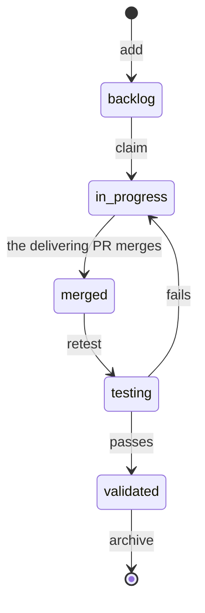

# Workflow

Copy this into your repo's `docs/board/TASKS.md`, and keep your own rules (promotion, batches,
reviews) in `WORKFLOW.md`.

| Step | Change in the task file | Where |
|---|---|---|
| Add | A new file, `status: "backlog"`, `added` = today | A small commit on `main` of the tickets repo |
| Claim | `owner`, `status: "in progress"`, `claimed` = today. Already owned: pick another task | A small commit on `main`, **before** branching in the code repo |
| Deliver | `status: "merged"`, the PR number in `pr`, an `## Evidence` section | A small commit on `main` once the code pull request merges. While a pull request whose title or branch names the task is open, the card shows In review |
| Retest | `status: "testing"` (and `tester`), then `"validated"`; on failure back to `"in progress"` with what failed | Small commits on `main` |
| Blocked | Set or clear `blocked_by` | A small commit |
| Abandon | `status: "backlog"`, clear `owner` and `claimed`, the reason in `## Evidence` | A small commit |
| Archive | Move to `archive/`, `status: "done"`, `done` = the date | A small commit, once the task has been validated for a while |



A claimed task stays where its status says until someone moves it. The status alone decides the
column.

Small commits touch only `docs/board/`. fuda pushes moves and owner changes straight to `main`, so
`main` must allow it. When a branch rule refuses the push, the move fails with a message saying `main`
is protected: give the people who move tasks permission to push to it.

## CI/CD

Task commits go to the tickets repository, which usually builds nothing. If a code repository still
has a `docs/board/` folder (for example a submodule pointer), skip builds when every changed file is
under it:

```yaml
# GitHub Actions
on:
  push:
    branches: [main]
    paths-ignore: ['docs/board/**']
  pull_request:
    paths-ignore: ['docs/board/**']
```

```yaml
# Azure Pipelines
trigger:
  branches: { include: [main] }
  paths:
    exclude: [docs/board/*]
```

On Azure DevOps, give the `main` build-validation policy the same path filter
(`!/docs/board/*`), or board-only pull requests will wait for a build.
